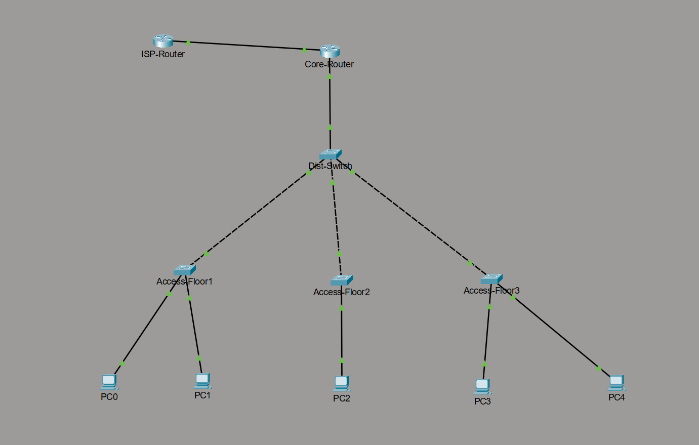
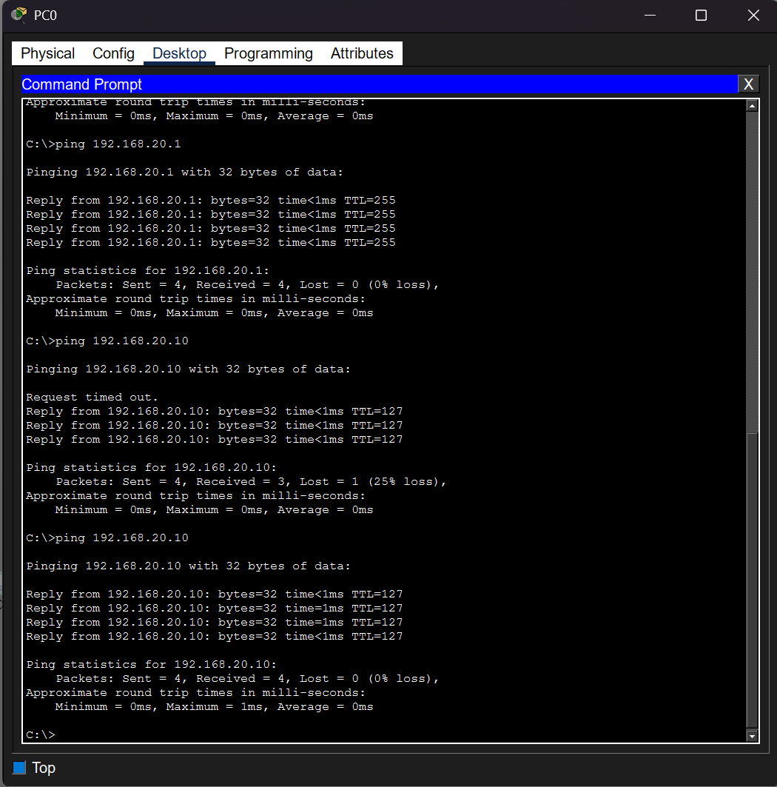
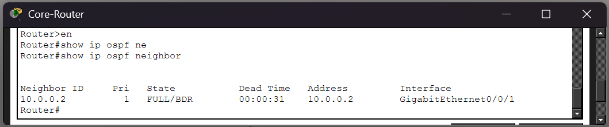

# 🏨 Enterprise Hotel Campus Network (3-Tier Architecture)

A comprehensive 3-tier enterprise campus network built and simulated in Cisco Packet Tracer. This project demonstrates strict network segmentation, dynamic routing, and Layer 2 security hardening designed for a high-traffic hospitality environment.

---

## 🏗️ Architecture & Topology
The network follows a classic Cisco 3-tier hierarchical design across three distinct floors:
* **Core Layer:** Cisco 4331 Router handling outbound external traffic via OSPFv2 and internal inter-VLAN routing (ROAS).
* **Distribution Layer:** Cisco 2960 Switch aggregating and trunking traffic from floor access switches up to the routing core.
* **Access Layer:** Dedicated Cisco 2960 switches for Floors 1, 2, and 3 serving departmental and guest end-devices.

---

## 🔒 Security & Traffic Isolation Implementations

### 1. VLAN Segmentation & Inter-VLAN Routing (ROAS)
To isolate departmental traffic and prevent unauthorized lateral movement, distinct VLANs were implemented via **Router-on-a-Stick (ROAS)** using 802.1Q encapsulation:
* **VLAN 10 (Admin / Reception):** `192.168.10.0/24` (Gateway: `192.168.10.1`)
* **VLAN 20 (Guest Wi-Fi):** `192.168.20.0/24` (Gateway: `192.168.10.1`)
* **VLAN 30 (Back Office / Security):** `192.168.30.0/24` (Gateway: `192.168.10.1`)

### 2. Dynamic Routing (OSPFv2)
Implemented **OSPFv2** in Area 0 to dynamically advertise internal subnets to the simulated ISP boundary, ensuring automatic route convergence without static routing overhead.

### 3. Layer 2 Hardening (DHCP Snooping & Port Security)
Hotels are high-risk environments prone to rogue devices. The Access Layer was hardened using:
* **DHCP Snooping:** Enabled globally and on all access VLANs, with uplinks set to `trust` to drop malicious `DHCPOFFER` packets from unauthorized rogue servers.
* **Port Security:** Configured access ports to statically bind the first connected MAC address (`mac-address sticky`), limited maximum MAC addresses to `1`, and set the violation mode to `shutdown` to mitigate MAC flooding and spoofing attacks.

